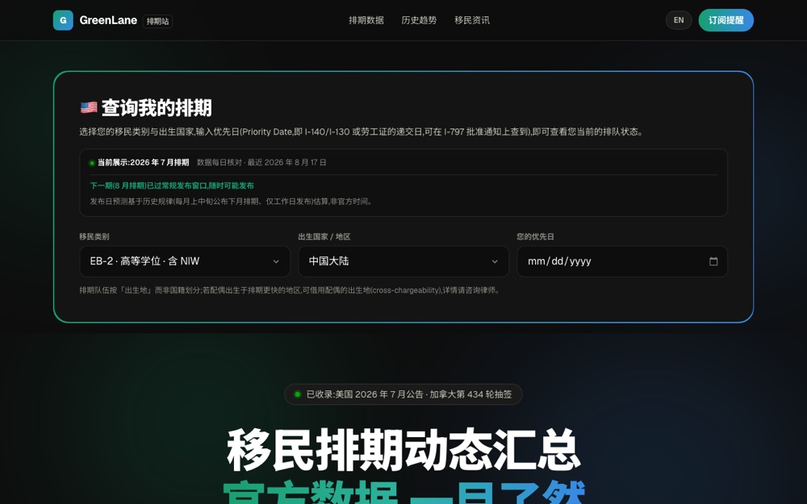

# GreenLane — Immigration Timeline Tracker

**▶ [Open the site](https://greenlane-beryl.vercel.app)**

A dashboard for immigration backlogs. US green card categories (EB-1 through EB-5, NIW and
family-based) sit alongside Canada's Express Entry draws, with ten years of history, wait
estimates per category and official regulatory news. Email alerts for when a cutoff date
moves are coming soon — the panel is in place, but no address is collected yet. Panels for
the UK, Australia and New Zealand are built; their data sources are being wired up.

Every figure comes from an official source. **This is not legal advice.**



*The dashboard — current cutoff dates and ten years of movement*

## Quick start

```bash
npm install
npm run dev        # http://localhost:3000
```

## Data pipelines

```bash
python3 scripts/scrape_bulletins.py --import FILE   # US bulletins: import one saved official page (see below)
python3 scripts/fetch_canada.py                     # Canada Express Entry draws (headless Chrome, works around Akamai)
python3 scripts/fetch_news.py                       # US Federal Register immigration rules (official free API)
```

Output lands in `src/data/`: `bulletins.json` (every US bulletin since October 2015), `canada.json`,
`live-news.json` (10 regulatory updates).

**US Visa Bulletin — imported by hand, once a month.** Since November 2026 both official State
Department hosts (`travel.state.gov` and `adoption.state.gov`) answer every scripted request with
a Cloudflare 403 block page, so the bulletin can no longer be fetched automatically, and we don't
try to get around the block. When a new bulletin is out (usually the 8th–16th of the month before):

1. Open the bulletin page in a normal browser.
2. Save it: Chrome → "Webpage, HTML Only"; Safari's default "Web Archive" works too.
3. Run `python3 scripts/scrape_bulletins.py --import ~/Downloads/<saved file>`, then commit and push.

The import runs the same parser and checks as the old fetcher: the page must be the month it
says it is, all four tables must be complete, and it must be either a revision of a recorded
month or the very next one. Re-importing identical content changes nothing.
`.github/workflows/bulletin-reminder.yml` checks daily: when a new bulletin is due it opens a
GitHub issue (one email), adds one overdue note if it is still missing the following month, and
closes the issue once the import is pushed. The network fetcher (`scrape_bulletins.py` without
`--import`) is kept in case the hosts reopen, but nothing runs it.

**Automatic updates (Canada + news):** `.github/workflows/update-data.yml` runs every hour at
:17 UTC and commits validated changes. GitHub may delay or drop individual scheduled runs.
Each file's `updatedAt` is the exact time new data was last found (UTC, to the second), and
the site shows it in the visitor's local time zone. A run whose only change is a refreshed
timestamp commits nothing (`scripts/keep_changed_only.mjs`), so Vercel deploys only when the
data actually changes. A stale US bulletin only raises a warning there, so it never blocks the
other updates.

Run regression checks with `python3 -m unittest discover -s scripts/tests -v` and
`node scripts/validate_data.mjs`. The August–October 2026 fixtures contain normalized official
table text retrieved on September 29, 2026; they exercise the parser and the import path.

One caveat — IRCC's Akamai
protection sometimes blocks data-centre IPs, so if the Canadian job fails on Actions, run
that script locally.

## Structure

| Path | Role |
|---|---|
| `scripts/` | The three ingestion pipelines above |
| `src/lib/bulletin.ts` | US timeline maths — advances and retrogressions, trend series, average pace, wait estimates |
| `src/lib/canada.ts` | Canadian draw categories and helpers |

Built with Next.js 15 and TypeScript, server-rendered.

---

© 2026 Weiren Feng. All rights reserved. Published for reading and portfolio purposes; not
licensed for reuse, modification, or redistribution.
